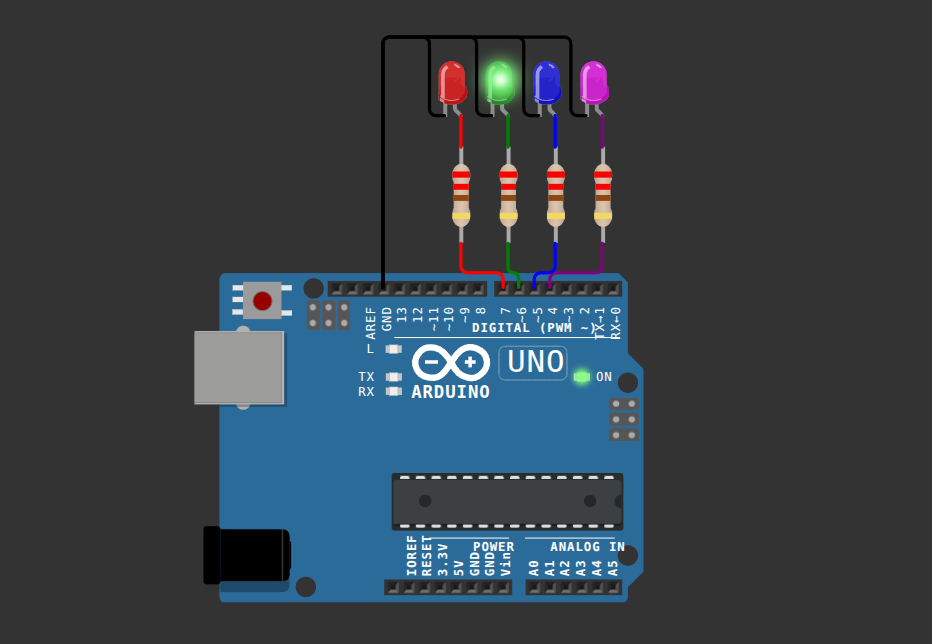
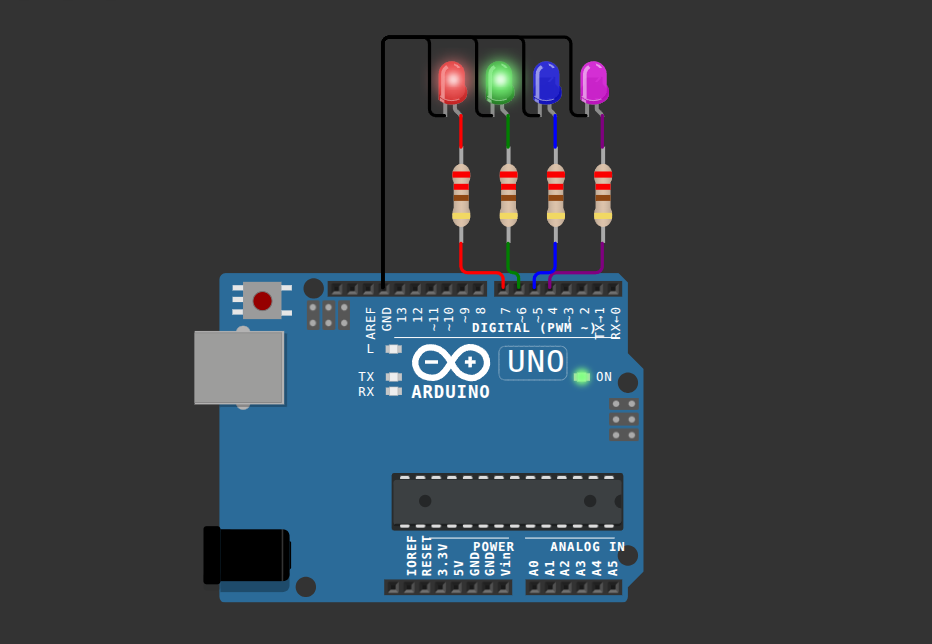
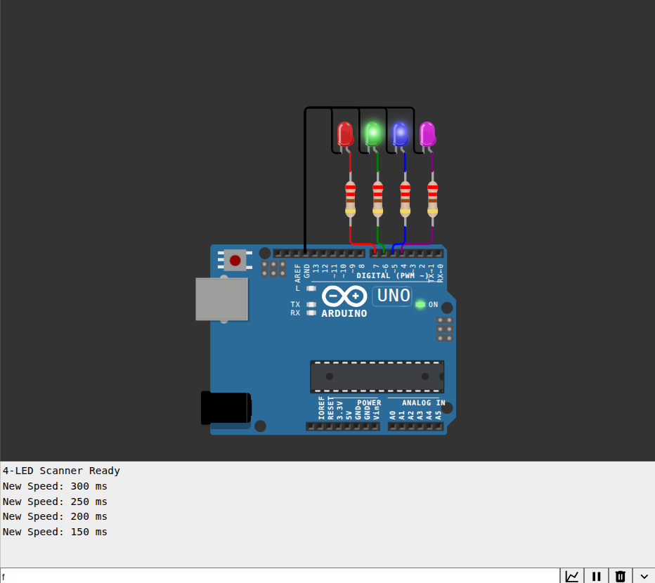

# Wokwi Simulation Evidence

| Screenshot | Description |
|---|---|
|  | Complete Arduino Uno and four-LED circuit |
|  | LEDs during forward-and-reverse scanning |
|  | Serial Monitor commands and updated delay output |

Verified behavior:
- LEDs scan from D4 to D7 and return from D6 to D5.
- `f` / `F` decreases the delay.
- `s` / `S` increases the delay.
- The updated delay is printed to the Serial Monitor.

These screenshots document simulator behavior only, not physical hardware testing.

